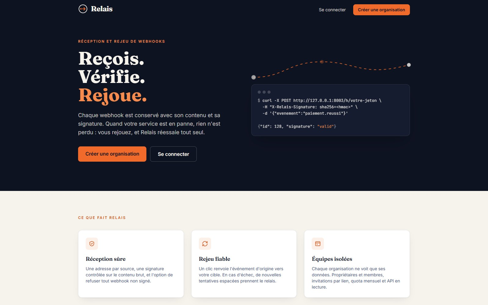
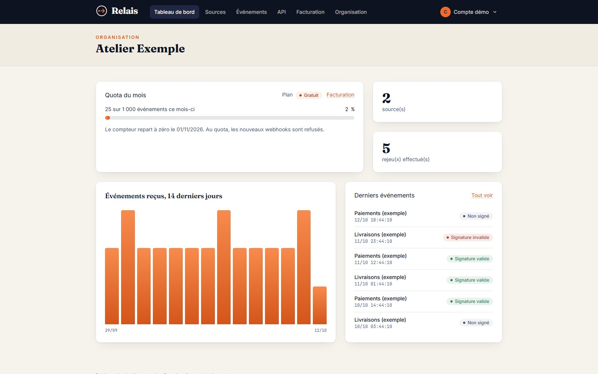
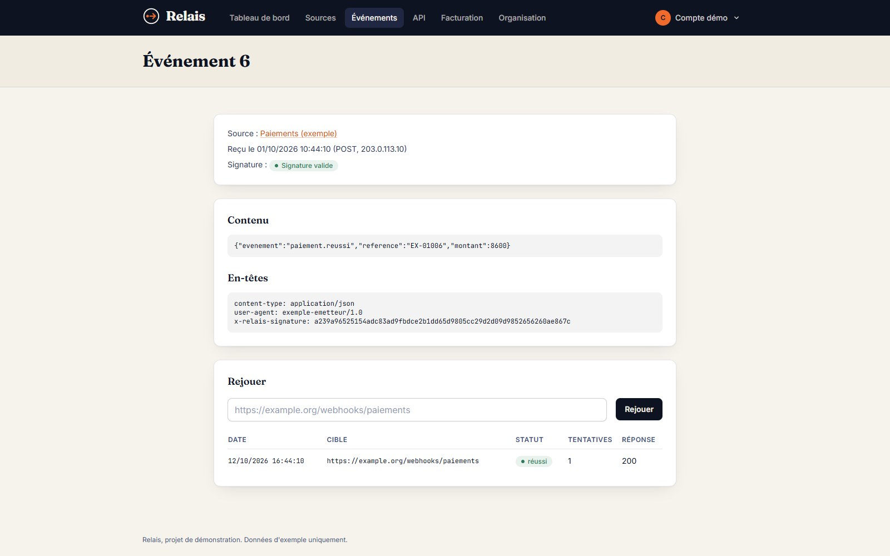

# Relais

[](https://github.com/TeddyRhim/relais/actions/workflows/ci.yml)
[](LICENSE)

Service de réception et de rejeu de webhooks. Une organisation crée des sources, chacune avec sa propre adresse de réception ; Relais conserve chaque webhook reçu, vérifie sa signature, permet de le rejouer vers une adresse cible avec de nouvelles tentatives automatiques, et mesure la consommation par rapport à un quota mensuel.

Projet de démonstration (Laravel 12, PHP 8.2, Blade et Tailwind, Pest).

## Aperçu







Les captures utilisent des données fictives (voir la commande de démonstration plus bas).

## Fonctionnalités

- Organisations avec deux rôles (propriétaire, membre) et invitations par lien.
- Sources avec adresse de réception dédiée et vérification de signature.
- Liste et détail des événements reçus, rejeu manuel avec suivi du statut et nouvelles tentatives espacées.
- Plans gratuit et Pro avec quota mensuel ; la facturation passe par une interface, avec un faux fournisseur pour la démonstration (aucun paiement réel).
- API en lecture seule, authentifiée par clés, avec limitation de débit.
- Interface en français.

## Installation

Prérequis : PHP 8.2 ou plus, Composer, Node.js.

```bash
composer install
cp .env.example .env
php artisan key:generate
php artisan migrate
npm install
npm run build
```

Lancer l'application et le traitement des rejeux (deux terminaux) :

```bash
php artisan serve
```

```bash
php artisan queue:work
```

### Compte de démonstration

La commande crée un compte et des données fictives. Elle demande l'adresse et le mot de passe, ou lit `DEMO_EMAIL` et `DEMO_PASSWORD` dans l'environnement. Aucun identifiant n'est fourni avec le dépôt.

```bash
php artisan relais:demo
```

### Docker

Créer un fichier `.env` contenant `APP_KEY` (obtenu avec `php artisan key:generate --show`) et `DB_PASSWORD`, puis :

```bash
docker compose up --build
```

L'application est servie sur le port 8080, avec PostgreSQL et un service dédié au traitement des rejeux. Le faux fournisseur de facturation y est activé explicitement (`RELAIS_ALLOW_FAKE_BILLING`) : à retirer avec un vrai fournisseur.

## API

Les clés se créent depuis la page « API » de l'interface. Elles donnent un accès en lecture seule aux sources et aux événements de l'organisation.

```bash
curl -H "Authorization: Bearer <clé>" http://localhost:8000/api/v1/events
```

Points d'accès : `GET /api/v1/sources`, `GET /api/v1/events` (paramètres `source` et `per_page`), `GET /api/v1/events/{id}`.

## Tests

```bash
php artisan test
vendor/bin/pint --test
```

Les tests utilisent SQLite en mémoire. Pour exécuter la suite sur PostgreSQL, définir `DB_CONNECTION=pgsql` et les variables de connexion d'une base dédiée aux tests ; c'est ce que fait l'intégration continue.

## Configuration

Les réglages propres au projet sont dans `config/relais.php` et se surchargent par variables d'environnement (voir `.env.example`). Aucun secret n'est versionné.

## Sécurité

Voir [SECURITY.md](SECURITY.md) pour signaler une vulnérabilité.

## Licence

Code distribué sous licence [MIT](LICENSE).
